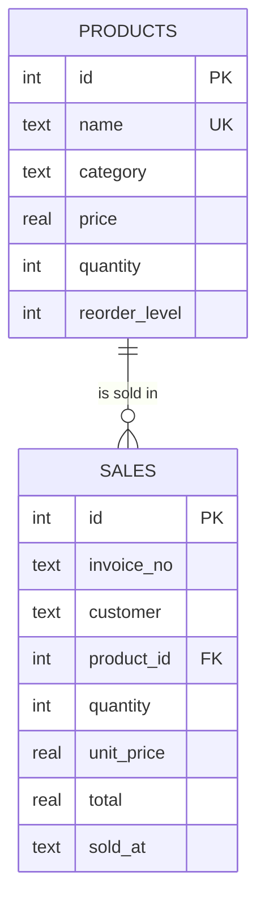

# 📦 Inventory Management System

A Python inventory and billing app with a **Streamlit web interface**. Manage products, sell items through a cart, generate **PDF invoices** automatically, and track performance on a **sales analytics dashboard**. Everything is stored in a local **SQLite** database, so there is no server or setup beyond `pip install`.


## ✨ Features

- **Product management (CRUD):** add, view, search, edit and delete products. Every change is saved to SQLite immediately.
- **Cart-based billing:** add several products to a cart and check out in one step. Stock is checked before the sale is accepted.
- **Automatic PDF invoices:** each sale generates a professional invoice (with 18% GST) using FPDF, downloadable straight from the app.
- **Sales analytics dashboard:** Matplotlib charts for top products by revenue, daily sales trend, revenue share by category, and stock levels against reorder levels.
- **Low-stock alerts:** products at or below their reorder level are flagged on the dashboard.
- **Sales history:** search past sales by customer or invoice number and export them to CSV.
- **Safe transactions:** a sale either fully succeeds or fully rolls back, so stock and sales records never get out of sync.
- **Two interfaces:** a Streamlit web app and a command-line menu that share the same core logic.

## 📸 Screenshots

### Sales dashboard


### Generated PDF invoice


> **Tip:** add your own screenshots of the Products and New Sale pages to `docs/` and link them here.

## 🛠️ Tech Stack

| Layer | Technology |
|---|---|
| Language | Python 3.9+ |
| Web UI | Streamlit, pandas |
| Database | SQLite3 (built into Python) |
| PDF invoices | FPDF (`fpdf2`) |
| Charts | Matplotlib |
| Testing | pytest, GitHub Actions |

## 🚀 Getting Started

### 1. Clone the repository
```bash
git clone https://github.com/YOUR_USERNAME/inventory-management-system.git
cd inventory-management-system
```

### 2. Create a virtual environment (recommended)
```bash
# Windows
python -m venv venv
venv\Scripts\activate

# macOS / Linux
python3 -m venv venv
source venv/bin/activate
```

### 3. Install dependencies
```bash
python -m pip install -r requirements.txt
```

> Install **`fpdf2`** (already in `requirements.txt`), not the older `fpdf` package. They share the same import name, but only `fpdf2` works with this project.

### 4. Run the app
```bash
python -m streamlit run app.py
```
The app opens at `http://localhost:8501`. On first run, click **Load demo data** in the sidebar to fill it with sample products and sales.

### Command-line version
```bash
python inventory_system.py          # interactive menu
python inventory_system.py --demo   # load sample data and save a dashboard PNG
```

## 🧭 How to Use

| Page | What you can do |
|---|---|
| **Dashboard** | See revenue, orders, units sold, low-stock items and the four analytics charts |
| **Products** | Search the catalogue, add new products, edit or delete existing ones |
| **New Sale** | Pick products, add them to the cart, check out, and download the PDF invoice |
| **Sales History** | Filter past sales and export them as CSV |

## 🗂️ Project Structure

```
inventory-management-system/
├── app.py                  # Streamlit web interface
├── inventory_system.py     # Core logic: database, billing, PDF invoices, analytics, CLI
├── tests/
│   └── test_inventory.py   # Unit tests (pytest)
├── docs/                   # Screenshots used in this README
├── .github/workflows/      # CI: runs the tests on every push
├── requirements.txt
├── requirements-dev.txt
├── LICENSE
└── README.md
```

Files created at runtime (and ignored by Git): `inventory.db`, `invoices/`, `sales_dashboard.png`.

## 🗄️ Database Design



`CHECK` constraints prevent negative prices and quantities, and a product with sales history cannot be deleted, which protects billing records.

## 🧠 Design Notes

- **Atomic sales:** `create_sale()` deducts stock and records every line item inside a single SQLite transaction. If any item is out of stock, the whole sale is rolled back.
- **Parameterized queries:** all SQL uses `?` placeholders to prevent SQL injection.
- **Separation of concerns:** `inventory_system.py` holds all business logic and knows nothing about Streamlit, so the same code powers both the web UI and the CLI, and it can be tested on its own.
- **Price snapshot:** each sale stores the unit price at the time of sale, so later price changes never alter past invoices.

## ✅ Running the Tests

```bash
python -m pip install -r requirements-dev.txt
python -m pytest -v
```

The tests use a temporary database and cover CRUD, duplicate handling, stock deduction, transaction rollback, low-stock detection and PDF creation.

## 🔮 Future Improvements

- User login with admin and staff roles
- Barcode / SKU support
- Supplier and purchase-order tracking
- Excel export for reports
- Configurable GST rate and store details
- Deployment on Streamlit Community Cloud with a hosted database

## 🤝 Contributing

Suggestions and pull requests are welcome. Open an issue first to discuss any major change.

## 📄 License

Released under the [MIT License](LICENSE).

## 👤 Author

**Your Name**
GitHub: [Manghadiya230156](https://github.com/Manghadiya230156) 
